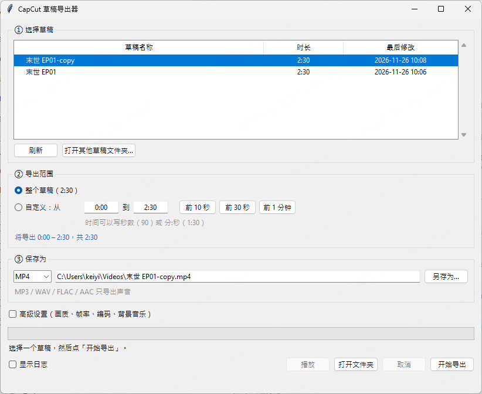
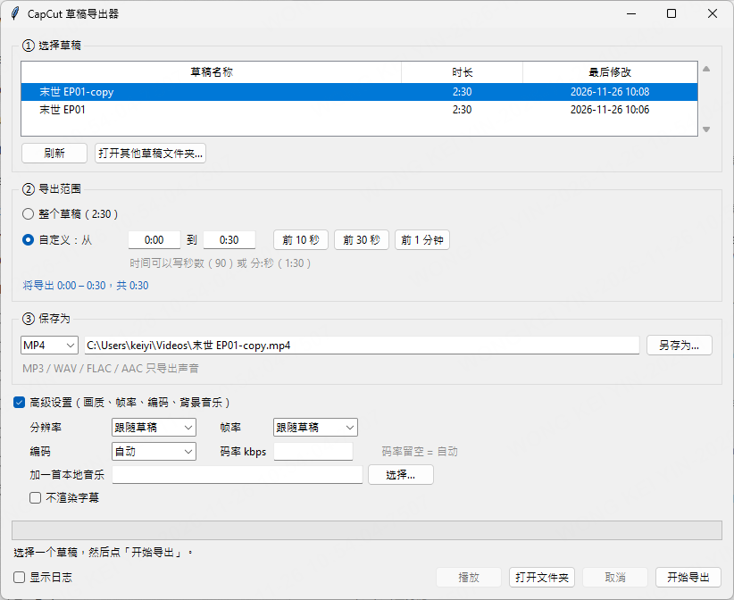
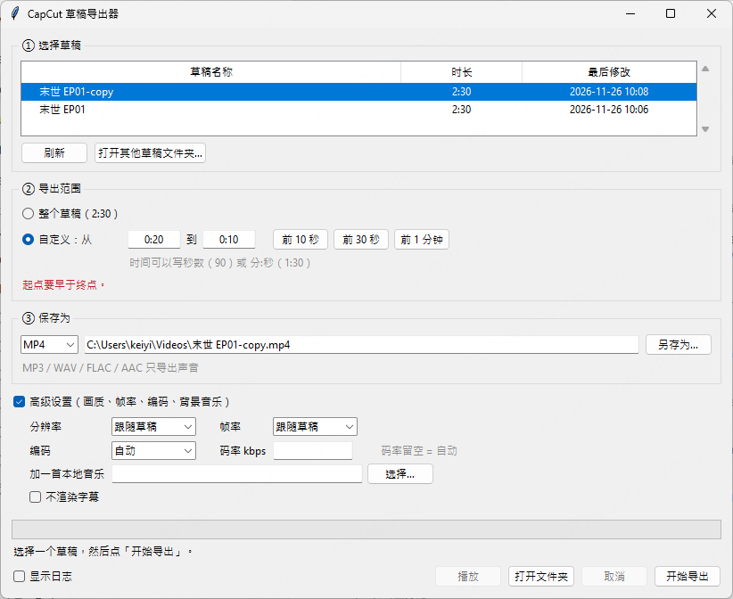
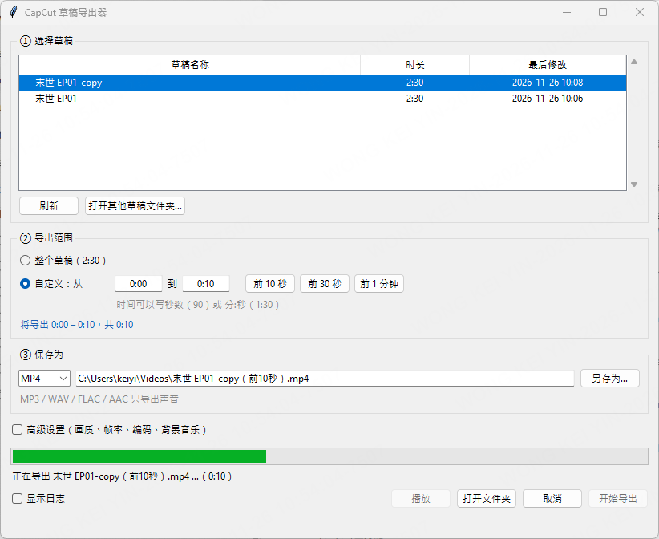
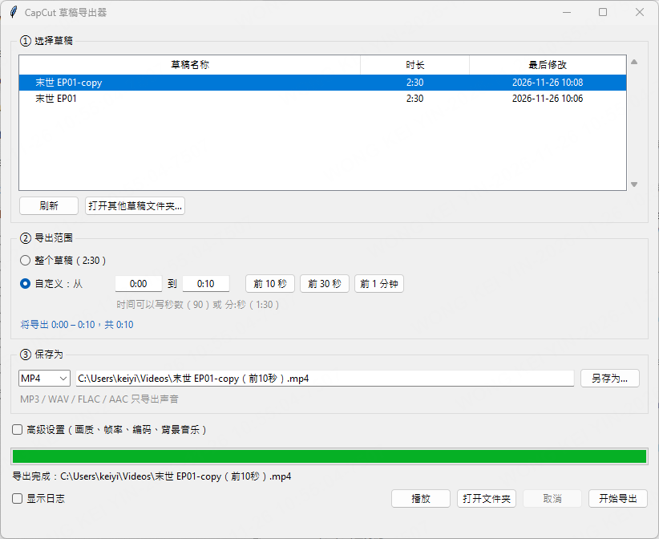

# CapCut 草稿导出器

不用打开 CapCut，也能把 **CapCut / 剪映电脑版** 的草稿导出成视频或音频。
可以导出整个草稿，也可以只导出其中一段（例如前 30 秒）。

*Export CapCut / Jianying desktop drafts to MP4 or audio without opening CapCut. Windows only. Download the zip from Releases, unzip, and double-click `CapCut导出器.exe`; no Python or FFmpeg install is needed.*



## 下载

1. 到 [Releases](https://github.com/keiyin-wong/CapCut-export/releases/latest) 下载 `CapCut导出器.zip`。
2. 解压整个文件夹。`CapCut导出器.exe` 要和 `render.exe`、`ffmpeg` 文件夹放在一起，不要只拿出 exe。
3. 双击 `CapCut导出器.exe`。

不需要安装 Python 或 FFmpeg。Windows 第一次运行时如果弹出「Windows 已保护你的电脑」，点「更多信息」→「仍要运行」。

## 怎么用

### ① 选择草稿

程序会自动列出这台电脑上的 CapCut 和剪映草稿，包括在 CapCut 设置里改过的草稿位置。最近修改的排在最上面。

列表里没有你的草稿时，点「打开其他草稿文件夹…」，选包含 `draft_content.json` 的那个文件夹。

### ② 选择导出范围

- **整个草稿**：从头导到尾。
- **自定义**：填起点和终点。时间可以写秒数（`90`）或 分:秒（`1:30`）。
- 「前 10 秒」「前 30 秒」「前 1 分钟」适合先试导一小段看效果。只导一小段时，程序只处理这一段用到的素材，所以很快。

勾选「高级设置」可以改分辨率、帧率、编码（H.264 / H.265）、码率，加一首本地背景音乐，或不渲染字幕。不改就跟随草稿。



时间填错时会马上用红字提示，例如起点晚于终点，或终点超过草稿时长：



### ③ 选择保存位置

左边选格式：MP4 / MOV 导出视频，MP3 / WAV / FLAC / AAC 只导出声音。默认保存在「视频」文件夹，文件名跟草稿名一样，可以点「另存为…」改。

### 开始导出

点「开始导出」，进度条会显示进度。中途可以点「取消」，没导完的文件会被删掉。



导完后点「播放」直接看，或点「打开文件夹」。



如果状态栏显示「有 N 条提示」，勾选「显示日志」可以看哪些效果被近似处理或跳过了。

## 支持什么

| 能还原 | 说明 |
| --- | --- |
| 多轨视频、图片、画中画 | 按轨道层级合成；缩放、位移、旋转、翻转、透明度 |
| 关键帧 | 位移、缩放、旋转、透明度、音量、字幕位移；线性插值，非线性缓动暂按线性处理 |
| 变速、倒放 | 恒定速度和倒放；变速曲线按平均速度 |
| 音频 | 原声、音效、背景音乐混音，按草稿音量，支持淡入淡出 |
| 转场 | 叠化（Mix）和部分标准转场，上层画中画也能转场 |
| 字幕 | 基本样式、位置、换行（含竖排） |
| 贴纸 | 本地图片贴纸、部分 CapCut 动态贴纸 |
| 滤镜 | 模糊、黑白、反色、暗角、本地 `.cube` LUT 调色 |

部分 CapCut 特效、花字、遮罩、复杂调色还不能完全还原，会近似处理或跳过。

## 注意

- 草稿用到的素材（视频、音频、贴纸）要在这台电脑上。草稿从别的电脑拷来时，程序会先在草稿文件夹里找同名素材，再找本机 CapCut / 剪映的缓存。
- 编码器会自动挑这台电脑能用的（Intel / NVIDIA / AMD 显卡编码，或 Windows 自带编码）。选 H.265 失败时请改回「自动」。
- 只支持 Windows。

## 从源码运行

需要 Python 3.10 以上（只用标准库和 tkinter），以及 FFmpeg。

1. 把 `ffmpeg.exe` 和 `ffprobe.exe` 放进项目的 `ffmpeg\` 文件夹（这两个文件太大，没有放进仓库），或者放进 PATH。
2. 双击 `startExport.bat`，或运行 `pythonw gui.py`。

命令行也可以直接导出：

```
python render.py "<草稿文件夹>" -o out.mp4 --start 0 --end 30
```

运行 `python render.py -h` 看全部参数。

### 打包

```
pip install pyinstaller
python -X utf8 build.py
```

生成 `dist\CapCut导出器\` 和 `dist\CapCut导出器.zip`。

## 文件

| 文件 | 作用 |
| --- | --- |
| `gui.py` | 图形界面 |
| `render.py` | 读草稿、用 FFmpeg 合成导出 |
| `build.py` | 打包成不需要 Python 的 zip |
| `buildTransitionTestDraft.py` | 生成测试转场和 LUT 用的草稿 |
| `exportNotes.md` | 开发笔记：草稿格式、已验证的功能、已知问题 |
| `使用说明.txt` | 放进 zip 里的使用说明 |
